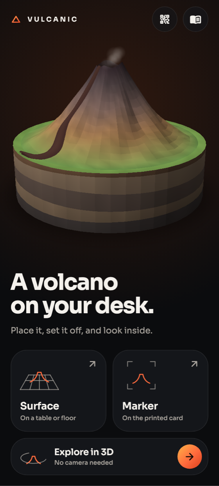
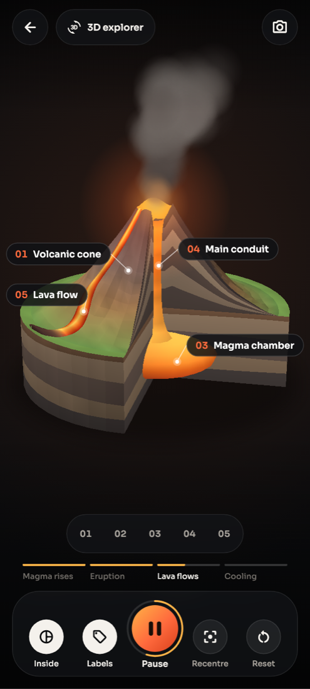
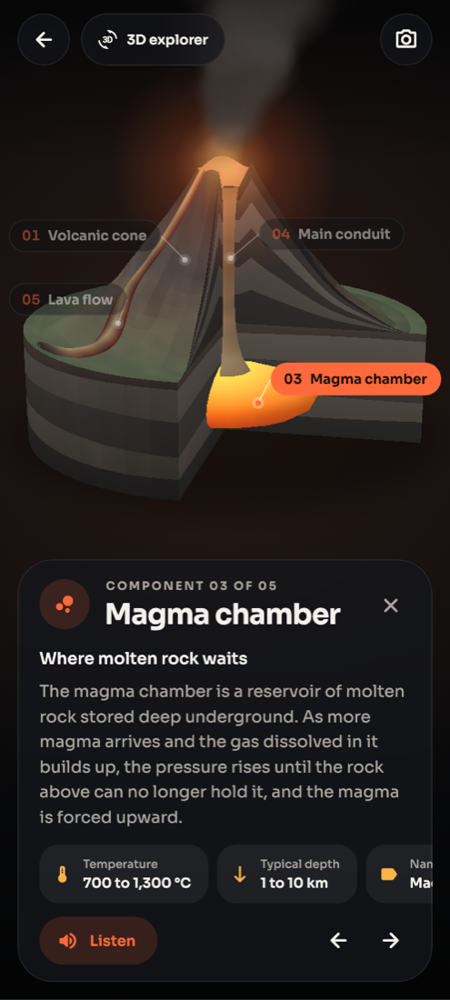
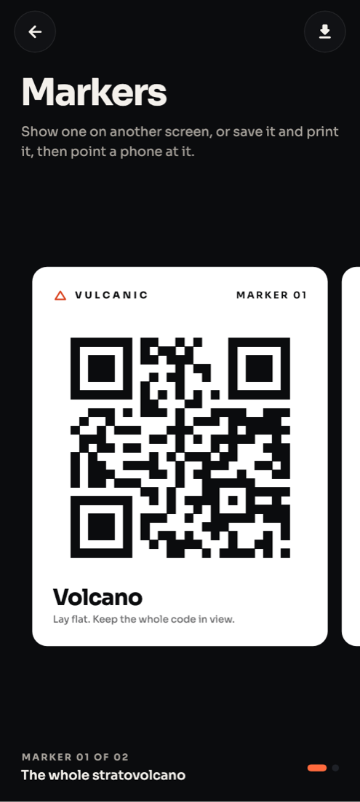
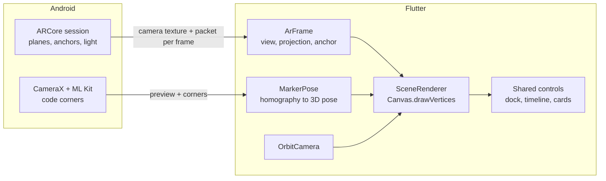

# Vulcanic

An interactive AR volcano for Android, built with Flutter.

Stand a stratovolcano on your desk, set off an eruption, open a cutaway down
to the magma chamber, and tap any of its five components to read or hear
what it does. It works three ways:

| Mode | Tracking | Needs |
| ---- | -------- | ----- |
| **Surface** | Markerless: ARCore plane detection and anchoring | An ARCore phone |
| **Marker** | Marker-based: a printed code, tracked in 3D | Any phone with a camera |
| **3D explorer** | None: orbit the model on a plain backdrop | Nothing |

Phones without ARCore are detected at run time. On them, Surface becomes
*screen placement* (tap the camera view to put the volcano there), and
Marker works exactly as it does everywhere else.

<p>
  
  
  
  
</p>

## Run it

Requires Flutter 3.47+ and a phone on Android 13 (API 33) or newer.

```bash
flutter run
```

Build an installable APK:

```bash
flutter build apk --release --split-per-abi
```

The APKs land in `build/app/outputs/flutter-apk/`; `app-arm64-v8a-release.apk`
is the one for almost every current phone.

## Using it

**Surface.** Point at a table or floor and move the phone slowly. Detected
surfaces are outlined and a ring shows where the volcano would stand. Tap to
place it, then walk around it. *Move* places it again; the grid button shows
or hides what the tracker sees.

**Marker.** Print a marker from [`docs/markers/`](docs/markers), or open
*Markers* in the app on a second device (the download button there saves a
printable copy to the gallery). Point the camera at it: the
volcano stands on the marker and follows it as it moves. Cover the marker or
take it out of view and the volcano fades out until it returns. Marker 02
opens straight into the cutaway.

**Everywhere.** Drag to turn, pinch to resize. *Erupt* plays a four-step
sequence (magma rises, eruption, lava flows, cooling). *Inside* opens the
cutaway. Tap a label or a number to open a component's card, and *Listen* to
have it read aloud. The camera button saves a picture to the gallery.

## How it is built



One renderer serves every mode. It only needs a view, a projection and a
model matrix, and each mode supplies them from a different source.

### The model

The volcano is five separately modeled components, each a plain OBJ file in
`assets/models/`:

| # | Component | File |
| - | --------- | ---- |
| 01 | Volcanic cone and crater | `cone.obj` |
| 02 | Ground and rock layers | `terrain.obj` |
| 03 | Magma chamber | `chamber.obj` |
| 04 | Main conduit | `conduit.obj` |
| 05 | Surface lava flow | `lava.obj` |

They are generated by `tool/forge_models.dart` and carry per-vertex colours,
so they open directly in Blender (File → Import → Wavefront). Re-export over
a file to change the model, or regenerate everything with:

```bash
dart run tool/forge_models.dart
```

### The renderer

`lib/engine/` draws the model with `Canvas.drawVertices`: no 3D engine and
no native rendering library. Triangles are transformed, culled and sorted on
the CPU. A canvas has no depth buffer, so `scene_renderer.dart` orders the
scene by splitting it into four quadrants that have a fixed far-to-near
order from any viewpoint; the cutaway is the same structure used in reverse.

### Markerless tracking

ARCore does the tracking and Flutter draws everything.

- `android/.../ar/ArSessionRunner.kt` runs the session on its own GL thread.
  It draws the camera image into a Flutter texture and packs each frame's
  view and projection matrices, anchor pose, plane outlines, feature points
  and light estimate into one array.
- `lib/ar/ar_session.dart` decodes it. `lib/ui/surface_screen.dart` draws
  the planes, feature points and placement ring, hit-tests a tap against a
  plane and creates the anchor.
- Tracking quality is shown live: the status pill, and a hint naming the
  cause when it degrades (too dark, moving too fast, too little detail).

### Marker tracking

- The marker is a card with a QR code that carries its identity
  (`VULCANIC:01`, `VULCANIC:02`), drawn by `lib/ui/marker_card.dart`.
- ML Kit finds the code and reports its four corners.
- `lib/ar/marker_pose.dart` turns four corners into a 3D pose: it fits the
  homography from the flat square to its image, then factors that into a
  rotation and a translation. Distances are in units of the code's width,
  so the marker can be printed at any size.
- `MarkerTracker` eases between detections and reports the marker lost when
  they stop.

### Narration

`lib/narration/` reads a component's description with Android's
text-to-speech, choosing a female English voice from those installed.

## Limits worth knowing

- **Screen placement is not anchored.** Without motion tracking the volcano
  stays where it is on the screen, not in the room.
- **Marker tracking assumes a typical camera field of view**, since the
  scanner does not report lens intrinsics. Perspective can be slightly off
  on unusual lenses. It also depends on the code being readable: glare,
  motion blur, or a steep angle will drop the lock.
- **Surface tracking needs light and texture.** Plain, glossy or dim
  surfaces are found slowly or not at all.
- **No occlusion.** The volcano always draws in front of real objects.
- Triangles that cross the camera's near plane are dropped, which only
  shows if you move the phone inside the model.

## Tests

```bash
flutter test
```

Covers the OBJ parser, the model's structure, the eruption timeline, the
AR packet decoder, placement and marker pose maths, voice selection, and
the screens themselves. `test/engine/render_dump_test.dart` and
`test/ui/screens_test.dart` also write PNGs to `build/renders/`.

## Credits

- Typeface: [Sora](https://github.com/sora-xor/sora-font), SIL Open Font
  License (`assets/fonts/OFL.txt`).
- Tracking: Google ARCore and ML Kit barcode scanning (via
  [mobile_scanner](https://pub.dev/packages/mobile_scanner)).
- Speech: [flutter_tts](https://pub.dev/packages/flutter_tts).
